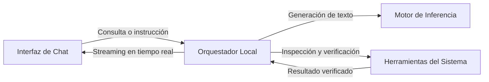

# Simple Domain

## ¿Para qué sirve?

**Simple Domain** es un asistente conversacional de código y razonamiento lógico que se ejecuta íntegramente en tu máquina local, sin enviar datos ni telemetría a servidores externos.

* **Asistencia de código local:** Genera, explica y depura código fuente sin depender de APIs de terceros ni conexión a internet.
* **Capacidades agénticas:** No se limita a predecir texto; puede inspeccionar archivos locales del proyecto y ejecutar herramientas de verificación deterministas sobre el entorno.
* **Privacidad absoluta y soberanía de datos:** Todo el cómputo y la memoria conversacional residen exclusivamente en tu hardware.

---

## Flujo Operativo



---

## ¿Cómo iniciarlo?

### Opción 1: Inicio Automatizado con Docker (Recomendado)

Verifica el modelo (lo descarga automáticamente en el primer uso si no existe) y levanta todo el entorno:

```bash
# Con Node.js (Windows, macOS o Linux)
node setup_and_dockerize.mjs
```

O mediante script de terminal en Linux / WSL:

```bash
chmod +x setup_and_dockerize.sh
./setup_and_dockerize.sh
```

Una vez finalizado, abre tu navegador en:
👉 **[http://localhost:5173](http://localhost:5173)**

---

### Opción 2: Ejecución Local Nativa (Sin Docker)

Si prefieres ejecutar directamente sobre el sistema operativo:

1. **Iniciar el motor y los servicios de fondo:**
   ```powershell
   .\start_stack.ps1
   ```

2. **Iniciar la interfaz gráfica:**
   ```bash
   cd frontend
   npm run dev
   ```

Abre tu navegador en 👉 **[http://localhost:5173](http://localhost:5173)**.

---

## Direcciones de Acceso

| Módulo | URL | Función |
| :--- | :--- | :--- |
| **Interfaz de Chat** | `http://localhost:5173` | Frontend visual para el usuario |
| **API Gateway** | `http://localhost:4000` | Endpoint conversacional local compatible con OpenAI |

---

## Preguntas Frecuentes

* **¿Por qué los pesos del modelo no se suben a Git?**  
  El archivo del modelo (~2 GB) supera el límite estricto de 100 MB de GitHub. El script de inicialización lo descarga automáticamente desde Hugging Face durante el primer arranque y queda guardado en local.
* **¿Funciona 100% offline?**  
  Sí. Tras la descarga inicial del modelo, el sistema opera con la red desconectada.
