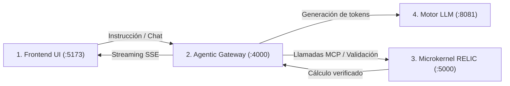

# Simple Domain

## ¿Para qué sirve?

**Simple Domain** es un asistente conversacional de código y razonamiento lógico que se ejecuta íntegramente en tu máquina local, sin enviar datos ni telemetría a servidores externos.

* **Asistencia de código local:** Genera, explica y depura código fuente sin depender de APIs de terceros ni conexión a internet.
* **Capacidades agénticas:** No se limita a predecir texto; puede inspeccionar archivos locales del proyecto y ejecutar herramientas de verificación deterministas sobre el entorno.
* **Privacidad absoluta y soberanía de datos:** Todo el cómputo y la memoria conversacional residen exclusivamente en tu hardware.

---

## Arquitectura de los 4 Puntos del Proyecto

El sistema está compuesto por 4 servicios desacoplados que cooperan localmente:

1. **Frontend UI (`:5173`)**: Aplicación web interactiva construida en React + TypeScript + Tailwind CSS y empaquetada con Vite.
2. **Agentic Gateway & MCP (`:4000`)**: Middleware en Node.js que orquesta las sesiones de chat, el streaming SSE, la memoria episódica y la ejecución segura de herramientas mediante MCP.
3. **Microkernel RELIC (`:5000`)**: Servidor determinista y formal escrito en Rust (`relic_server`) para cálculos exactos, resolución de grafos y validación transaccional.
4. **Motor de Inferencia LLM (`:8081` / `:8080`)**: Motor `llama.cpp` ejecutando el modelo Dolphin 3B Q4_K_M de forma puramente local.



---

## ¿Cómo iniciarlo?

### Opción A: Runner Multi-Plataforma Unificado en Python (Recomendado)

Funciona de forma idéntica en **Windows, Linux y macOS**. Detecta automáticamente el sistema operativo, instala dependencias faltantes (`npm install`, comprobación del modelo) y muestra los logs de los 4 servicios en tiempo real organizados en 4 paneles dentro de la misma terminal:

```bash
python run.py
```

* Presiona `Ctrl+C` en cualquier momento para detener los 4 procesos de forma limpia.

---

### Opción B: Despliegue en Docker Compose

Si prefieres aislar todo el entorno en contenedores Docker:

```bash
# Vía script automatizado (Linux / WSL / macOS)
chmod +x setup_and_dockerize.sh
./setup_and_dockerize.sh

# O mediante Node.js
node setup_and_dockerize.mjs

# O directamente con Docker Compose
docker compose up --build -d
```

---

### Opción C: Comandos de Inicio Individuales (Terminales Separadas)

Si prefieres abrir 4 consolas distintas:

#### 1. Motor de Inferencia LLM (Puerto 8081)
```bash
cd llm_server
./llama-server -m dolphin-2.9.4-llama3.2-3b-q4_k_m.gguf -c 2048 -t 2 -ngl 0 --host 127.0.0.1 --port 8081 --flash-attn off
```

#### 2. Microkernel RELIC Server (Puerto 5000)
```bash
cd relic
cargo run --release -p relic_server
```

#### 3. Agentic Gateway & MCP (Puerto 4000)
```bash
cd llm_server/agentic_gateway
npm install
node server.mjs
```

#### 4. Frontend Web UI (Puerto 5173)
```bash
cd frontend
npm install
npm run dev
```

Una vez iniciados, abre tu navegador en:
👉 **[http://localhost:5173](http://localhost:5173)**

---

## Direcciones de Acceso y Puertos

| Punto / Servicio | Directorio | Puerto / URL | Rol |
| :--- | :--- | :--- | :--- |
| **1. Frontend Web** | `frontend/` | `http://localhost:5173` | Interfaz gráfica de usuario y terminal de chat |
| **2. Agentic Gateway** | `llm_server/agentic_gateway/` | `http://localhost:4000` | Orquestador de agentes, MCP, sesiones y memoria |
| **3. Servidor RELIC** | `relic/` | `http://localhost:5000` | Motor formal determinista y validación transaccional |
| **4. Motor LLM** | `llm_server/` | `http://localhost:8081` | Servidor `llama.cpp` con Dolphin 3B Q4_K_M |

---

## Preguntas Frecuentes

* **¿Cómo detener los servicios iniciados con `run.py`?**  
  Basta con presionar `Ctrl + C` en la terminal; el script captura la señal y finaliza los 4 subprocesos hijos automáticamente.
* **¿Por qué los pesos del modelo no se suben a Git?**  
  El archivo del modelo (~2 GB) supera el límite estricto de GitHub. `run.py` o el script `setup_and_dockerize.sh` lo descargan automáticamente en el primer arranque y queda guardado en local.
* **¿Funciona 100% offline?**  
  Sí. Tras la descarga inicial del modelo, todo el sistema opera sin conexión a internet.
