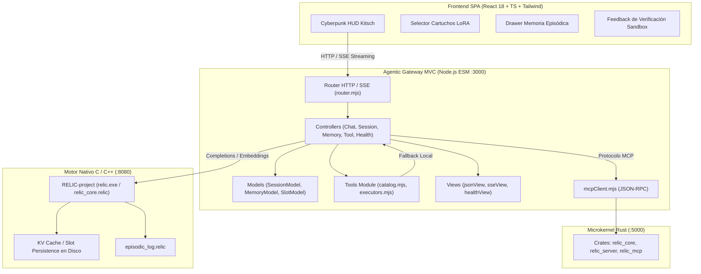

# Simple Domain — Documentación Técnica de Arquitectura y Rutas

Este documento detalla la arquitectura interna del sistema, el flujo de datos entre capas, el árbol de directorios detallado y la especificación completa de rutas y endpoints de la API.

---

## 1. Arquitectura del Sistema



---

## 2. Estructura Detallada del Repositorio

```text
Simple_Domain/
├── agentic_gateway/         # Middleware MVC Node.js ESM (< 180 líneas por archivo)
│   ├── config.mjs          # Parámetros (PORT: 3000, RELIC_ENGINE_URL: 8080)
│   ├── server.mjs          # Bootstrap del servidor e inyección de dependencias
│   ├── controllers/        # Controladores de negocio (chat, session, memory, tool, health)
│   ├── models/             # Modelos de datos (SessionModel, MemoryModel, SlotModel)
│   ├── views/              # Vistas de serialización (jsonView, sseView, healthView)
│   ├── routes/             # Enrutador desacoplado (router.mjs)
│   ├── tools/              # Herramientas locales y puente MCP (catalog, executors, index)
│   ├── tests/              # Suite de pruebas unitarias (sessions, memory, tools, router, views)
│   └── mcpClient.mjs       # Cliente JSON-RPC hacia relic_mcp en Rust
│
├── frontend/               # Interfaz Cyberpunk HUD (React 18 + TS + Vite + Tailwind)
│   ├── src/
│   │   ├── components/     # Componentes HUD (< 180 líneas)
│   │   ├── hooks/          # Custom hooks desacoplados (useChat, useChatStream, useChatSessions)
│   │   ├── services/       # Conectores RELIC (relicClient, relicStreamService, relicMemoryService)
│   │   ├── views/          # Vistas SPA (HomeView, ChatFeed, QuickActionTiles)
│   │   └── types/          # Definiciones TypeScript de dominio y API
│   ├── nginx.conf          # Servidor Nginx para producción
│   └── Dockerfile          # Multi-stage build optimizado
│
├── relic_mcp/              # Microkernel de verificación determinista en Rust (:5000)
│   ├── crates/             # Crates Rust (relic_core, relic_server, relic_mcp)
│   ├── schemas/            # Esquemas JSON de validación
│   └── Cargo.toml          # Manifiesto de dependencias Cargo
│
├── tests/                  # Pruebas globales organizadas
│   ├── integration/        # Pruebas de integración de Gateway y herramientas
│   ├── benchmarks/         # Scripts de rendimiento y evaluación de modelos
│   ├── python/             # Suites de pruebas en Python
│   ├── reports/            # Informes JSON y Markdown de benchmarking
│   └── fixtures/           # Datos estáticos de prueba
│
├── docs/                   # Documentación técnica extendida
├── docker-compose.yml      # Orquestación de contenedores (relic_ai, gateway, frontend)
├── run.py                  # Dashboard y runner de procesos unificado en terminal
└── README.md               # Documentación principal simplificada
```

---

## 3. Especificación de Rutas y Endpoints

### 3.1. Diagnóstico del Sistema
- **`GET /health`**
  - Devuelve estado de salud general, estado del microkernel MCP, herramientas registradas, sesiones activas y memoria episódica.
  - *Respuesta:* `{ status: "ok", engine: "RELIC-project", mcp: true, toolsCount: 4, sessionsCount: 1, memoriesCount: 0 }`

### 3.2. Gestión de Sesiones (`/v1/sessions`)
- **`GET /v1/sessions`**: Lista todas las sesiones ordenadas por fecha de actualización reciente.
- **`POST /v1/sessions`**: Crea una nueva sesión. Admite `{ title?: string, messages?: [] }`.
- **`GET /v1/sessions/:id`**: Obtiene una sesión con sus mensajes (soporta query params `?limit=100&offset=0`).
- **`PATCH /v1/sessions/:id`**: Actualiza el título de una conversación (`{ title: string }`).
- **`DELETE /v1/sessions/:id`**: Elimina la sesión y purga su slot en disco.
- **`POST /v1/sessions/:id/messages`**: Agrega o sincroniza mensajes dentro de una sesión específica.

### 3.3. Memoria Episódica (`/v1/relic/memory`)
- **`GET /v1/relic/memory`**: Consulta todos los registros y conclusiones aprendidas.
- **`POST /v1/relic/memory`**: Registra un nuevo hallazgo técnico (`{ topic: string, conclusion: string }`).
- **`DELETE /v1/relic/memory/:id`**: Elimina una conclusión por su ID único.

### 3.4. Herramientas y Sandbox (`/v1/tools`)
- **`GET /v1/tools`**: Lista el catálogo unificado de herramientas (Rust MCP + Locales).
- **`POST /v1/tools/execute`**: Ejecuta una herramienta en el sandbox de cuarentena (`{ name: string, arguments: object }`).

### 3.5. Inferencia y Streaming (`/v1/chat/completions`)
- **`POST /v1/chat/completions`**: Despacha inferencia streaming Server-Sent Events (SSE). Orquesta restauración automática de slots KV, inyección de memoria episódica y guardado de snapshots.

---

## 4. Mejoras Técnicas Implementadas

1. **Modularización Estricta (< 180 líneas por archivo):** Desacoplamiento total de monolitos en frontend y gateway.
2. **Arquitectura MVC:** Separación limpia de Modelos (persistencia atómica), Vistas (serializadores HTTP/SSE) y Controladores (lógica de negocio).
3. **Módulo de Herramientas Independiente:** Directorio `tools/` con schemas canónicos y ejecutores aislados con fallback automático.
4. **Pruebas Automatizadas:** 21 pruebas unitarias en `agentic_gateway` con el motor nativo `node:test`.

